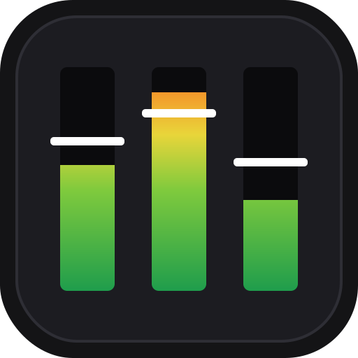

# Compact Mixer for LUNA

A narrow mixer for big LUNA sessions, in a floating window. On a large monitor it shows 80+
tracks and their buses on one screen.

## Features

- **The fader is the meter.** Each lane shows the audio level on LUNA's own meter scale
  (0 dBFS at the top, then −3, −6 … −21, −27, −36, −46, −60 evenly spaced) as one continuous
  green-to-red gradient with held-peak lines. The fader is a thin white line across it: drag
  anywhere on the lane to move it (no jump), double-click for 0 dB, arrow keys to nudge. The
  number under the lane is the fader value; the number above is the highest level since you
  last clicked it.
- **dB ruler** on the left, labelled AUDIO dBFS and lined up with every lane. Hover any lane to
  read the level at the pointer.
- **Two strip widths** (the ⇔ button), with mute and solo on every track, bus and folder, and
  the Main Output pinned on the right.
- **Wide strips.** The selected channel, and any channel you pin (the pin appears on hover),
  open wide with:
  - inserts: power to bypass, name ↗ to open the plugin window. The console slot (LUNA
    Channel, API Vision…) is listed first and tagged CONSOLE;
  - an EQ curve, read from the plugins' band parameters (view only);
  - the routed sends, with level, mute and pre-fader;
  - pan.
  Click empty space in the mixer, or the selected channel's name, to narrow it again.
- **Filter** by name (commas for alternatives: `vox, gtr`), by kind (Audio, Inst, Bus, Cue;
  Option-click a kind to show only it) and by track colour.
- **S / M** clear every solo or unmute every channel, as one undo step.
- **Move channels** in LUNA's own track order with the ◀ ▶ buttons on a wide strip, or
  Option+←/→ for the selected channel.
- **Transport bar:** return to zero, back/forward one bar, stop, play, record, loop, position,
  tempo and time signature.
- **LUNA Mixer** shows LUNA's own Mixer and folds this window to a thin bar; **Compact Mixer**
  unfolds it again.

Every fader, pan and send drag is one undo step in LUNA.

## Install

Requires LUNA 3.1.2 or later. Install it from LUNA's Add On marketplace, or download
`compact-mixer.lunaaddon` from the latest release and double-click it. Then open a session and
choose **Add Ons > Windows > Compact Mixer**.

## En español

Un mezclador estrecho para sesiones grandes de LUNA, en una ventana flotante: más de 80 pistas
en una pantalla. Cada carril es fader y medidor a la vez, en la escala de audio de LUNA, con una
regla en dBFS. El canal seleccionado (o los que fijes) se abre ancho con insertos, curva de EQ,
envíos y panorama. Incluye filtros, reordenación de canales en LUNA, barra de transporte y un
botón para pasar al mezclador de LUNA.

## Licence

Copyright (c) 2026 Fede Trillo. All rights reserved. Free to install and use in LUNA; the code
may not be copied, modified or redistributed. See [LICENSE](LICENSE). The bundled LUNA Builder
SDK is Universal Audio's, under the Apache License 2.0: see
[THIRD_PARTY_NOTICES.md](THIRD_PARTY_NOTICES.md).

Contact: fedetrillo@gmail.com
